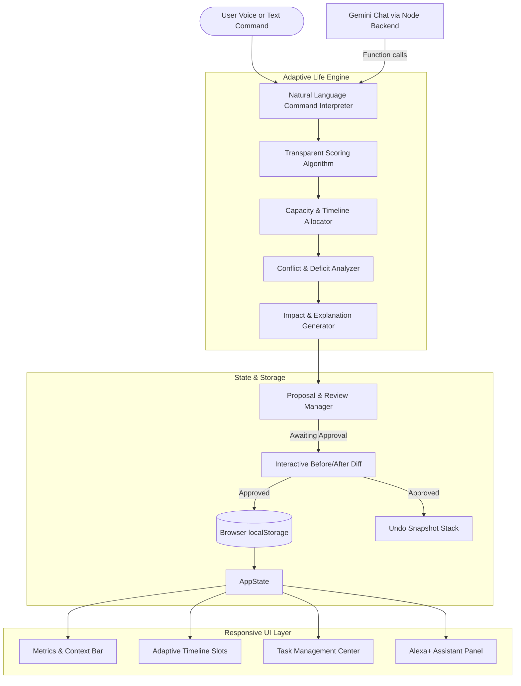

# AimFlow AI
> **“Plan That Bend. Dream That Don't.”**

---

## 1. Project Identity & Overview
- **Product Name:** AimFlow AI
- **Tagline:** “Plan That Bend. Dream That Don't.”
- **Hackathon Track:** Alexa+ Track (Simulated Assistant Experience)
- **Project Type:** Simulated Alexa+-style personal assistant for the Amazon Developer Hackathon
- **Target Users:** Students and self-directed learners managing tight exam timetables, shifting assignment deadlines, surprise commitments, and finite daily study capacity.

---

## 2. Problem Statement
Most planners merely record static lists of to-dos. When an unexpected event happens—such as an exam moved earlier, a sick day, or an urgent commitment—standard calendar and to-do apps either silently overflow or force the user into tedious manual rescheduling. Conversely, many AI chat assistants only provide generic, ungrounded advice without inspecting actual constraints or trade-offs.

Students are left asking:
> *"My hackathon deadline moved to tomorrow, I only have one hour to study today, and I still have two assignments left. What changed, what does it affect, and what should I do next?"*

---

## 3. Target Users
- **University & College Students:** Balancing multiple courses, concurrent lab deadlines, exam revision, and extracurricular hackathons.
- **Bootcamp Students & Independent Learners:** Operating under intense daily project schedules where losing two hours has cascading consequences on remaining deadlines.
- **Young Professionals with Evening Studies:** Needing deterministic scheduling that respects fixed non-negotiable personal hours.

---

## 4. Proposed Solution
AimFlow AI provides a proactive, context-aware scheduling assistant with a real deterministic scheduling and impact engine. 

The defining experience follows an adaptive feedback loop:
```
Change Detected ➔ Impact Analyzed ➔ Conflicts Identified ➔ Plan Rebuilt ➔ Trade-offs Explained ➔ User Approves ➔ Schedule Saved
```

Instead of fabricating productivity statistics or offering vague encouragement, AimFlow:
1. Detects changes in available time, deadlines, and task completions.
2. Mathematically calculates capacity conflicts against finite daily study hours.
3. Prioritizes nearest urgent deadlines while protecting completed work.
4. Generates an explainable Before / After comparison with real minutes and task shifts.
5. Requests explicit user approval before committing consequential schedule updates.
6. Persists state locally across sessions with full undo support.

---

## 5. What Makes AimFlow Distinctive
- **Real Deterministic Scheduling:** Zero mock responses, random numbers, or canned strings. Every schedule, timeline block, and warning is computed by a real algorithmic engine.
- **Transparent Trade-Off Explanations:** Answers *"Why did you move my programming task?"* and *"What changed?"* directly from real change diffs.
- **Pre-Commit Proposal Review:** Major replanning is presented as an interactive proposal card with a side-by-side Before/After diff, allowing users to apply or reject changes.
- **Honest Capacity Accounting:** Never pretends that 5 hours of work can fit into a 1-hour window. If a task cannot fit, it is transparently flagged as **At Risk** with an exact minutes deficit.
- **Alexa+ Design Language:** Features an Alexa-inspired dark aesthetic, glowing interactive avatar ring, audio sound cues, optional Web Speech API voice synthesis, and quick prompt chips.

---

## 6. Core Features
- **Adaptive Life Engine:** Natural language parser capable of understanding deadline shifts, available time reductions, new commitments, task completions, and compound multi-intent commands.
- **Executive Dashboard:** Live metrics displaying today's available time, scheduled focus minutes, tasks due soon, tasks at risk, and sprint completion percentage.
- **Adaptive Timeline:** Generates chronological focus blocks with realistic clock times and built-in 5-minute buffer intervals.
- **Comprehensive Task Ledger:** Create, edit, complete, search, filter, and delete tasks with validated durations, categories, priorities, and deadlines.
- **Interactive Proposal Cards:** Review changes with clear "What changed?", "What AimFlow adapted", "Why?", and Before/After metrics before applying.
- **Context-Aware Alexa+ Chat:** Remembers selected tasks, responds to follow-up questions, and answers *"What should I do next?"*.
- **Undo & Revert Capability:** One-click restoration of previous schedules via header button or chat command (*"Undo that"*).
- **One-Click Hackathon Demo Mode:** Loads the standardized hackathon scenario and executes the compound challenge prompt with a single click.
- **Full Offline Persistence:** All tasks, constraints, chat messages, and undo history persist in browser `localStorage`.

---

## 7. How the Adaptive Scheduling Engine Works

### A. Task Scoring Formula
Active tasks are prioritized using a transparent scoring algorithm that combines **Deadline Urgency** and **Task Priority**:

$$\text{Composite Score} = (\text{Urgency Points} \times 1.5) + (\text{Priority Points} \times 1.0)$$

#### 1. Urgency Points
Based on the number of days until the deadline:
- **Overdue (< 0 days):** 100 points
- **Due Today (0 days):** 90 points
- **Due Tomorrow (1 day):** 80 points
- **Due in 2 Days:** 60 points
- **Due in 3 Days:** 45 points
- **Due in 4–6 Days:** 30 points
- **Due $\ge$ 7 Days:** 15 points

#### 2. Priority Points
- **High Priority:** 50 points
- **Medium Priority:** 30 points
- **Low Priority:** 10 points

#### 3. Tie-Breaking
When two tasks have identical composite scores, the engine applies the **Shortest Processing Time (SPT)** heuristic, scheduling shorter tasks first to maximize completed commitments.

### B. Capacity Allocation & Conflict Handling
1. **Preserve Completed Work:** Completed tasks consume 0 future study minutes and remain intact.
2. **Net Available Capacity:**
   $$\text{Net Capacity} = \text{Available Study Time} - \sum \text{Commitment Durations}$$
3. **Allocation Loop:** Iterating through tasks ordered by composite score:
   - **Full Fit:** If task duration $\le$ remaining capacity, the task is scheduled in full.
   - **Partial Focus Block:** If remaining capacity $> 0$ but less than task duration, the engine allocates the maximum available focus block and flags the remaining duration as **At Risk** for future study windows.
   - **Postponed / Unscheduled:** If remaining capacity is 0, the task is postponed. If its deadline is within 24–48 hours, it is flagged with a **Capacity Conflict** warning.

---

## 8. Architecture & Technology Stack

### Technology Stack
- **Structure:** HTML5 (Semantic, accessible markup with ARIA roles)
- **Styling:** Vanilla CSS3 (Custom design system, glassmorphism, responsive grid, zero CSS frameworks)
- **Frontend logic:** Vanilla JavaScript ES6+ (zero frontend framework or bundler)
- **Backend:** Node.js 18+ HTTP server with the Google `@google/genai` SDK; Gemini requests are made server-side.
- **Storage:** Browser `localStorage` for tasks, constraints, chat messages, and undo history.
- **Audio & Voice:** Web Audio API (Alexa-style chimes) and Web Speech API (`SpeechSynthesis` & `SpeechRecognition`)

### Architecture Diagram


---

## 9. Folder Structure
```
AimFlow-ai/
├── index.html        # Main application structure and semantic UI
├── style.css         # Alexa+ dark theme design system and layout
├── script.js         # Deterministic engine, NL parser, UI rendering, persistence
├── server.js         # Local HTTP backend and Gemini API proxy
├── package.json      # Node scripts and Gemini SDK dependency
├── README.md         # Comprehensive documentation and evaluation guide
├── LICENSE           # MIT License (2026)
├── .gitignore        # Standard ignore rules
└── assets/
    └── favicon.svg   # Custom Alexa+ gradient ring & pilot spark icon
```

---

## 10. Instructions to Run Locally
Node.js 18 or later is required for the Gemini backend. Keep the Gemini key in the private `.env` file; never put it in `script.js`, `index.html`, or a public hosting setting.

1. Install dependencies with `npm ci` (in Windows PowerShell, use `npm.cmd ci` if script execution is blocked).
2. Copy `.env.example` to `.env` if needed and add a valid `GEMINI_API_KEY`. Keep `AI_PROVIDER` and `GEMINI_MODEL` set to the desired server-side provider and model.
3. Start the app with `npm start` (in Windows PowerShell, use `npm.cmd start` if needed).
4. Open `http://localhost:3000` and verify `http://localhost:3000/api/health` reports the expected provider and model.

The backend serves the frontend and proxies Gemini requests. The deterministic task engine, voice UI where the browser supports it, and local browser storage remain in the frontend; direct file or static-only hosting does not provide the Gemini backend.

---

## 11. Hosting Notes
GitHub Pages can host static files only; it does not run this Node.js backend. A hosted version that uses Gemini needs a separately hosted backend and a server-side secret configuration. Do not publish `.env` or expose an API key in frontend code. No deployment or Amazon Alexa+ service connection is included in this project.

---

## 12. Supported Example Commands
AimFlow recognizes natural phrasing variations across key student scenarios:

| Category | Example Phrasing |
| :--- | :--- |
| **Deadline Shifts** | *“My hackathon deadline moved to tomorrow.”*<br>*“Move my assignment deadline to Friday.”*<br>*“Project is due in 2 days.”* |
| **Available Time Changes** | *“I only have one hour to study today.”*<br>*“Available time is 90 minutes.”*<br>*“I can study for 2 hours today.”* |
| **Compound Scenarios** | *“My hackathon deadline moved to tomorrow, and I only have one hour to study today.”* |
| **Task Completion** | *“I finished my mathematics revision.”*<br>*“Done with programming assignment.”* |
| **Unexpected Commitments** | *“I have an unexpected two-hour commitment.”*<br>*“Doctor appointment for 45 minutes.”* |
| **Explainability** | *“Why did you move my programming task?”*<br>*“Why did you change that?”*<br>*“Show me what changed.”* |
| **Next Actions** | *“What should I do next?”*<br>*“What's my next task?”* |
| **Undo / Revert** | *“Undo that.”*<br>*“Undo the last change.”* |
| **Add New Task** | *“Add task Physics Lab due tomorrow 60 minutes high priority.”* |

---

## 13. Known Limitations
- **Local Rule-Based Parser:** The command interpreter is a fast, deterministic JavaScript pattern matcher. Highly idiosyncratic idioms or ungrammatical compound slang outside supported regex patterns will prompt a helpful fallback message.
- **Single-Device Local Storage:** Data is persisted in the local browser's `localStorage`; no cloud sync across devices is implemented.
- **Voice Recognition Availability:** Speech recognition uses the browser's native Web Speech API (`SpeechRecognition`/`webkitSpeechRecognition`) and requires browser support and microphone permission. The microphone control is hidden where recognition is unavailable; typing remains available.

---

## 14. Testing
The checklist below was already documented in the project; its “Verified” labels are not results from the current test run. The automated suites cover deterministic logic and simulated UI flows. Mocked AI tests do not prove a real Gemini request succeeds, and browser microphone permissions, cross-browser responsive behavior, and Amazon Alexa+ integration require separate testing.

| # | Test Scenario | Previously Documented Status |
| :---: | :--- | :---: |
| 1 | Application opens directly from `index.html` without build step | Verified |
| 2 | No external CDNs, frameworks, or runtime dependencies required | Verified |
| 3 | Task can be created, edited, completed, and deleted | Verified |
| 4 | Task deadlines and durations are validated against invalid inputs | Verified |
| 5 | Natural language commands parse variations in wording | Verified |
| 6 | Deadline change identifies affected commitments | Verified |
| 7 | Time reduction produces a realistic, capacity-respecting schedule | Verified |
| 8 | Completed tasks remain completed and consume zero future time | Verified |
| 9 | Unscheduled work is preserved and reported with deficit minutes | Verified |
| 10 | Proposed changes can be rejected without altering the active schedule | Verified |
| 11 | Approved changes persist across browser page refreshes | Verified |
| 12 | Undo safely restores the exact previous state | Verified |
| 13 | “What changed?” reflects real revision history | Verified |
| 14 | “Why did you move that?” outputs actual mathematical rationale | Verified |
| 15 | “Reset Demo” button cleanly restores the 4-task baseline scenario | Verified |
| 16 | Unsupported phrases fail gracefully with helpful example chips | Verified |
| 17 | User text is sanitized (`textContent` / DOM creation) preventing XSS | Verified |
| 18 | Fully responsive layout across mobile and desktop viewport widths | Verified |
| 19 | Full keyboard navigation and visible focus rings | Verified |
| 20 | All displayed metrics derive strictly from actual application state | Verified |

---

## 15. Hackathon Track & Simulation Disclosure
- **Track:** Alexa+ Track
- **Simulation Disclosure:** AimFlow AI is a simulated Alexa+-style web experience for the Amazon Developer Hackathon. It has a local Node.js backend that can call Google Gemini when correctly configured, a browser-based voice input path where supported, and a deterministic task and scheduling engine with local browser persistence. It is not an official Amazon product and does not connect to Amazon Alexa+ services or provide an Alexa+ Agent Skill/MCP integration.

---

## 16. License Information
This project is licensed under the **MIT License**. See the [LICENSE](LICENSE) file for complete details.
